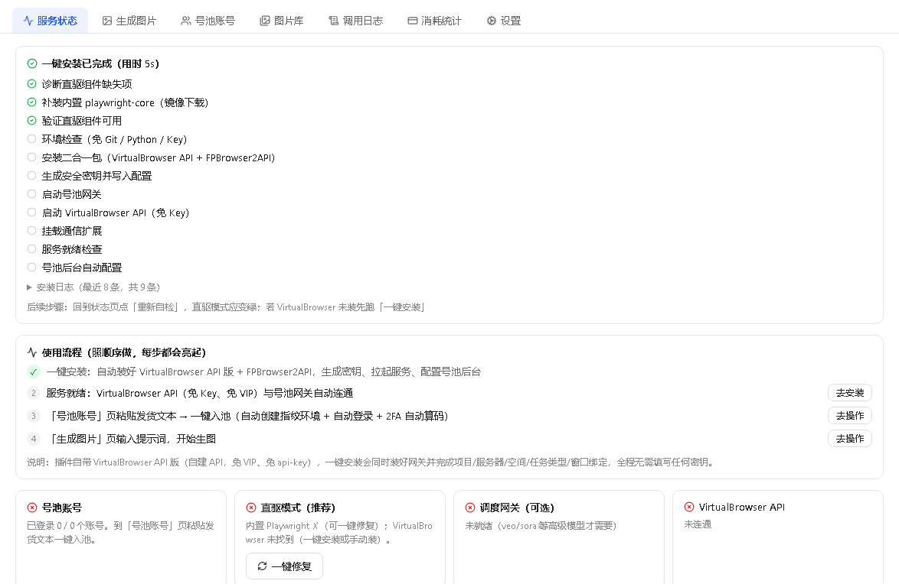
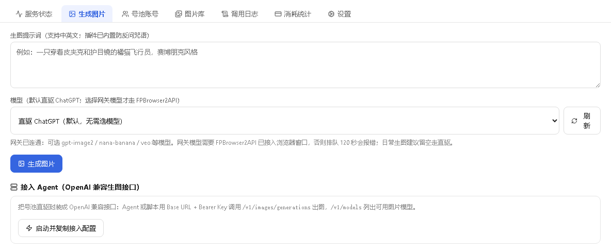
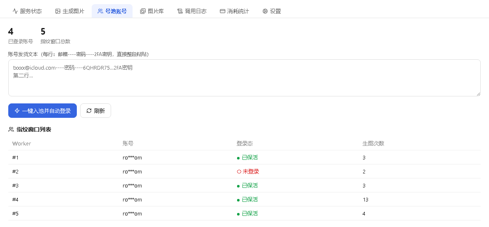
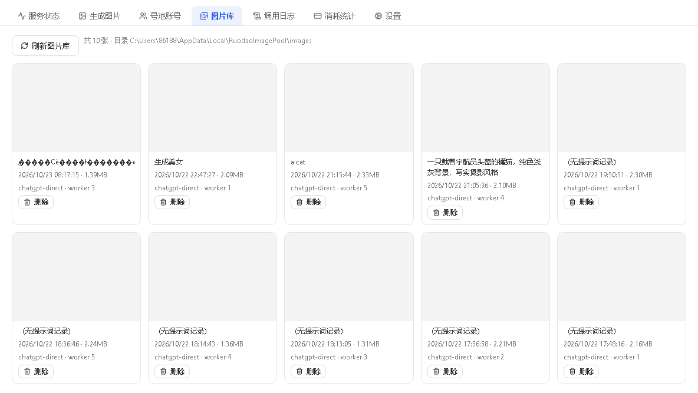
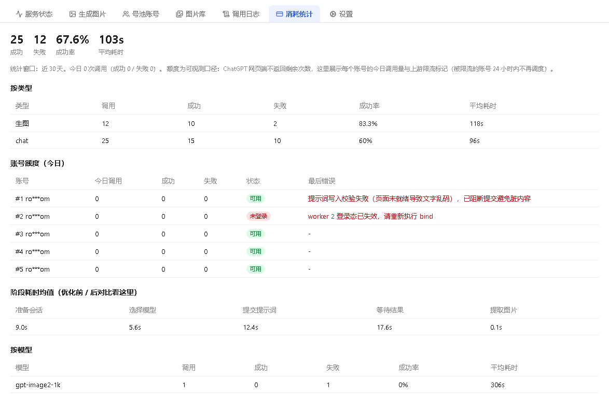

# 生图号池（VirtualBrowser + FPBrowser2API 二合一，装好就能出图）

> 想用网页版生图模型批量出图，卡点从来不是"会不会写提示词"，而是**环境**：装 Git、装 Python、配 API Key、找教程、改配置、再发现指纹窗口起不来。
>
> 生图号池把这一整套做成**一个二合一安装包 + 一个工作台**：装完自动起网关、自动起 VirtualBrowser API、自动登录入池，粘贴账号就能用；出图走内嵌 Playwright 直连，免网关；还能把号池暴露成本地 **OpenAI 兼容接口**接进若道 Agent。调用日志、图片库、消耗统计全在本地。

**📦 一键安装**：[https://ruodao.com/plugin-market/items/image-pool](https://ruodao.com/plugin-market/items/image-pool)（若道桌面端「功能插件市场」搜索"生图号池"，或市场页直接「下载 ZIP」用本地安装导入。）

---

## 💎 五个理由

### 📦 1. 免 Git、免 Python、免 API Key

二合一安装包一次装好 **VirtualBrowser API + FPBrowser2API** 两端。装完自动写配置、启动网关、启动浏览器 API，环境自检两盏灯全绿即可用。缺组件有「一键修复」，更新报 `EBUSY` 有「修复占用」。

### 🔑 2. 粘贴发货文本，自动登录入池

买号后拿到的文本（每行 `邮箱----密码----2FA密钥`）直接粘进去：插件为每个账号创建**独立指纹窗口**，打开站点自动登录，2FA 自动填。密码在界面脱敏展示，落盘加密。

### 🎨 3. 生图 + 对话，两条路都通

号池有已登录账号时走**直驱模式**（内嵌 Playwright 直连 VirtualBrowser，免网关）；失败自动换下一个账号重试。也支持网关模式调 `gpt-image2` / `nana` 系列模型。对话同理。

### 🔌 4. 变成 OpenAI 兼容接口，接进任何 Agent

「接入 Agent」启动本地直驱 API（默认 `127.0.0.1:8100`），返回 OpenAI 兼容的 base URL 与 Bearer，注册成模型提供方后，若道 Agent 里就能直接调生图与对话。

### 📊 5. 每一张图、每一次调用都有账

本地台账记录类型（生图/对话）、模型、账号、成功失败、耗时与各阶段耗时；图片库列出全部生成图片（文件、提示词、模型、账号、时间、本地预览 URL）；消耗统计按账号给今日额度概览。

## 🖼️ 界面预览

| 服务状态 | 生成图片 |
| --- | --- |
| [](docs/screenshots/1.png) | [](docs/screenshots/2.png) |

| 号池账号 | 图片库 |
| --- | --- |
| [](docs/screenshots/3.png) | [](docs/screenshots/4.png) |

| 消耗统计 |  |
| --- | --- |
| [](docs/screenshots/5.png) |  |

## ✨ 功能总览

| 能力 | 说明 |
| --- | --- |
| 📦 **一键安装** | 全自动搭建号池：定位二合一包 → 安装 → 写配置 → 启动网关 → 启动浏览器 API，进度可轮询 |
| 🔧 **一键修复 / 修复占用** | 补装直驱组件（playwright-core / 浏览器内核）；清理更新残留进程解 `EBUSY` |
| ⚙️ **号池后台自动配置** | 自动登录后台（同步/重置弱密钥）→ 建项目 → 建浏览器服务器 → 全流程 `provision` |
| 🔍 **环境自检** | FPBrowser2API（默认 `:8002`）与 VirtualBrowser API（默认 `:9000`）连通性 |
| 🖼️ **生成图片** | 直驱优先、失败换号；支持网关模式；任务可查询 |
| 💬 **对话** | 同样走号池通道 |
| 🔑 **账号入池** | 发货文本一键导入，解析去重、密码脱敏、独立指纹窗口自动登录 |
| 🕵️ **风控伪装自检** | 用 worker 打开反机器人检测页，验证 `navigator.webdriver` 等指纹项 |
| 🔥 **加速守护 / 预热** | 常驻浏览器池预热 N 个窗口，省掉每次 10–30 秒冷启动 |
| 📈 **台账 / 日志 / 图片库 / 消耗统计** | 全本地记录，可查可删 |

## 📥 安装

1. 下载并安装 [若道桌面端](https://ruodao.com)。
2. 「功能插件市场」→ 搜索 **生图号池** → 安装（安装包约数百 MB，含虚拟浏览器运行时）。
3. 打开工作台 → **一键安装** → 等步骤跑完（环境检查 / 二合一安装 / 写配置 / 启动网关 / 启动浏览器 API）。
4. **号池账号**页粘贴发货文本 → 等待自动登录完成。

> 仓库只包含插件源码；安装包（`vendor/allinone`，约 450MB 的 exe）与 `vendor/playwright-core` 运行时体积过大未入库，请从插件市场安装获取。

## 🚀 使用教程

### 第一次用

1. 一键安装 → 环境自检两盏灯绿；
2. 号池账号 → 粘贴 `邮箱----密码----2FA` 文本 → 导入；
3. 打开搭建助手（`http://127.0.0.1:8765`）看 worker 是否已登录；
4. 生成图片页输入提示词 → 出图进图片库。

### 接进 Agent

「接入 Agent」→ 复制返回的 base URL 与 Key → 在模型管理里注册为 OpenAI 兼容提供方 → 之后在对话里就能直接调生图。

### 提速

号池账号页开「加速守护进程」→ 预热 2–3 个窗口 → 后续出图省掉冷启动。

## 🛠️ 二次开发

```
├── plugin.json           # 元信息
├── ruodao-plugin.json    # 核心：id、权限、22 个命令
├── ui.json               # 工作台界面
├── bin/image-pool.mjs    # 主命令入口
├── bin/image-api.mjs     # 本地 OpenAI 兼容 API（:8100）
├── bin/direct.mjs        # 直驱模式（Playwright 直连 VirtualBrowser）
├── bin/ledger.mjs        # 本地台账（调用记录 / 统计）
├── bin/pool-models.mjs   # 模型清单
├── vendor/assistant/     # FPBrowser 搭建助手（Python + Web 控制台）
├── test/                 # 台账与插件测试
└── docs/screenshots/     # 本页截图
```

```bash
node --test test/
```

## 🔐 隐私与边界

- 账号、密码、2FA 密钥、Cookie **只存在本机数据目录**，界面脱敏展示；
- 所有出图请求从本机指纹窗口发出，不经插件服务器中转；
- 插件不提供任何账号，也不做平台风控绕过——用的是你自己购买的账号与浏览器指纹的合规登录。

## 📦 更新日志

- **v1.2.1**（当前开源版本）：一键安装/修复/修复占用、号池自动配置、直驱生图与 OpenAI 兼容接入、台账与消耗统计、加速守护与预热。

## 🔗 相关

- 插件市场页：[https://ruodao.com/plugin-market/items/image-pool](https://ruodao.com/plugin-market/items/image-pool)
- 若道官网：[https://ruodao.com](https://ruodao.com)
- 更多插件源码：[https://github.com/ruodaoai](https://github.com/ruodaoai)

## License

MIT。请遵守所用平台的服务条款。
